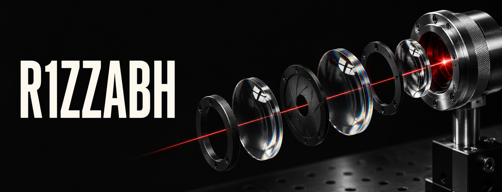

  

I’m **Rishabh**. I build security tools, run adversarial learning experiments, and prototype AI products.

## Selected work

**[SignalForge](https://github.com/R1zzabh/signalforge)**  
A security operations lab for triaging alerts, scoring risk, and mapping incidents to MITRE ATT&CK.  
`FastAPI` · `Next.js` · `UiPath`

**[VIOLET](https://github.com/R1zzabh/violet-rl)**  
A cyber range for studying how attacker and defender policies learn in isolated HTTP environments.  
`Python` · `Reinforcement learning` · `Docker`

**[MinuteBloom AI](https://github.com/R1zzabh/minute-bloom-ai)**  
Turns meeting recordings into timestamped transcripts, decisions, and editable action items.  
`TypeScript` · `Next.js` · `Supabase`

**[TasteBridge](https://github.com/R1zzabh/NL-Spotify)**  
A Spotify discovery case study about giving listeners control over how far recommendations stray from familiar music.

Inside the security labs

In **SignalForge**, an isolated Docker range feeds telemetry into the same pipeline the operator console uses to show alert enrichment, risk scores, and incident timelines.

In **VIOLET**, separate red and blue PPO policies train in a SQL injection lab. Saved episodes expose policy decisions and verified outcomes for replay.

[Browse all repositories →](https://github.com/R1zzabh?tab=repositories)
